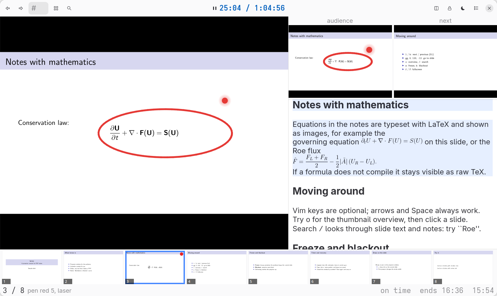

# lectos

A presenter tool for Linux. You give it PDF slides and, optionally, lecture notes; it gives you a presenter console (current and next slide, notes, timer, search, overview) and a projector window for the audience, with pen, laser pointer, chalkboard, blackout and freeze.



> This project is vibe-coded. Treat documented support boundaries and quality gates as the source of truth, and verify behavior for your use case.

## Install

You need Python 3.13+ and [uv](https://docs.astral.sh/uv/), plus system packages that Python cannot install: GTK 4, libadwaita 1.4+, PyGObject and the Poppler GObject typelib. Optional: `latex` and `dvipng` (typeset math in notes), `zathura` (alternative projector), `pdftoppm`, `pdftotext` and `chafa` (terminal console).

```bash
git clone https://github.com/CKPEIIKA/lectos.git
cd lectos
uv venv --system-site-packages --python /usr/bin/python3.13   # PyGObject comes from the system
uv sync --locked
```

## Run

```bash
uv run lectos                                  # opens a window: choose slides, notes or a folder
uv run lectos slides.pdf                       # notes next to it (slides.tex or slides.md) are used
uv run lectos slides.pdf notes.md              # or name them
uv run lectos talk/                            # a folder with the PDF and its notes
uv run lectos-tui slides.pdf                   # terminal console, Zathura as projector, no GTK
uv run lectos examples/slides.pdf              # try the sample deck
```

With two monitors the projector window goes fullscreen on the last one; with one it stays a window (`f` toggles fullscreen). Quit with `q`, `:q` or by closing the console; the page, timer, notes position, layout and your drawings are restored next time.

## The basics

| key | action |
|---|---|
| `l` / `h`, arrows, Space | next / previous slide |
| `:` | command line (Tab completes, `:help` lists every command) |
| `o`, `/` | overview grid, search |
| `z`, `b`, `B` | freeze projector, blackout, chalkboard |
| `d`, `e`, `p` | mouse drawing, eraser, laser pointer |
| `s` | quick drawing layout |
| `E`, `S` | edit this slide's notes, settings |
| `t`, `f`, `F` | timer, projector fullscreen, console fullscreen |

Everything the interface does is a command on the `:` line, and the menu button holds every action. Notes are Markdown (`<!-- slide: N -->` markers) or a Beamer `.tex` with `\note{}`; you can edit them in the console, and a `.tex` is never changed. The interface speaks English, Russian and German.

Everything else is in the [user guide](docs/usage.md): layouts, hiding panels, drawing and laser, notes formats, the terminal console, the `options.toml` reference and the screenshots. Short manual pages: `man -l man/lectos.1`.

## Configure

`$XDG_CONFIG_HOME/lectos/options.toml` (or `--config FILE`); a missing file means defaults. See [`examples/options.toml`](examples/options.toml) for every key.

## Develop

```bash
uv sync --group dev
./scripts/quality.sh        # ruff, ty, pytest with 100% coverage (the GTK tests need a display)
```

Layout of the repository and the rules for contributors are in [`AGENTS.md`](AGENTS.md); open work is in `TODO.md`, finished work in `DONE.md`, and `lectos/` is split into subpackages (`model`, `control`, `notes`, `draw`, `projectors`, `gtk`, `term`).

## License

GPL-3.0-only, see [LICENSE](LICENSE). Nothing from other projects is bundled; lectos uses GTK 4, libadwaita, PyGObject, pycairo, Poppler, Zathura, chafa, LaTeX and dvipng as separate programs or libraries.
