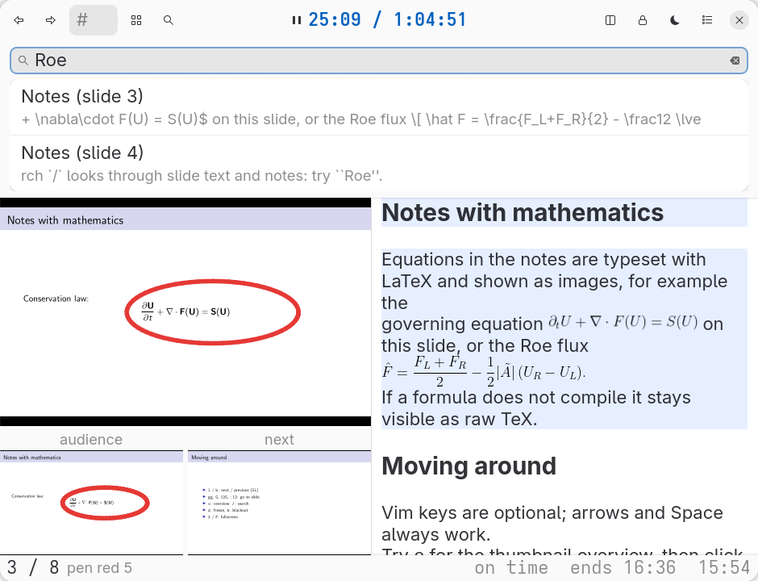
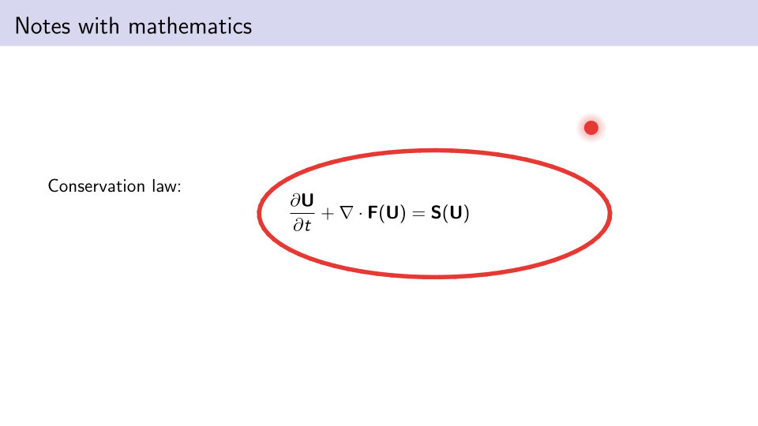

# lectos user guide

The full reference. For installation and the first run see the [README](../README.md).

## Overview

`lectos` has two independent parts: the **projector** (what the audience sees) and the **console** (what you work with: current, projected and next slide, timer, overview, search and scrollable notes). Pick each separately with `--console` / `--projector` or `[ui]` in `options.toml`; flags beat the options file, which beats the entry point's default.


| Compact layout with the search panel open | What the audience sees |
|---|---|
|  |  |

| console \ projector | `gtk` (our window) | `zathura` | `none` |
|---|---|---|---|
| `gtk` (default for `lectos`) | everything | slides only | slides only |
| `tui` (default for `lectos-tui`, with `zathura`) | notes, search, timer, freeze, blackout, chalkboard, ink tools | notes, search, timer, freeze | notes only |

- **gtk projector**: our window; supports blackout screen (picture/text), chalkboard, ink, laser. Needs GTK 4, PyGObject and the Poppler typelib.
- **zathura projector**: a plain Zathura window driven over D-Bus (`gdbus`); follows the deck, freeze works, fullscreen via `fullscreen`. It cannot show blackout, chalkboard, ink or laser, so those commands answer "not supported by this projector".
- **gtk console**: all features below, including drawing and the laser on the preview. Needs GTK as above.
- **tui console** (`lectos-tui`, or `--console tui`): standard-library Python in the terminal, no GTK unless combined with the gtk projector. Slide previews use `pdftoppm` and `chafa` (Unicode block characters; skipped in terminals narrower than 90 columns or when the tools are missing). Notes are shown as styled text; math is approximated with Unicode (`∂ₜ U + ∇·F(U) = S(U)`), not typeset. Overview and search results are lists. It has no laser, no `show-slide`, no mouse; with the gtk projector you can still draw on the projector window with a pen (or a mouse after `draw on`). Keys are always vim-style plus arrows; `:` opens the command line with Tab completion; `:q` quits (Ctrl-C also saves and quits). `?` or `:help` opens a list of every command usable with this projector (usage, description, key; commands that need the GTK console or a projector with more features are marked); Enter on an entry starts typing it, and `:help NAME` describes one command. With the gtk projector, GTK's own messages are written to `$XDG_STATE_HOME/lectos/<id>.log` so they cannot garble the screen.

The GTK console opens a console window; with the gtk projector it also opens the projector window. It follows the GNOME design guidelines through libadwaita (1.4 or newer): a toolbar view with header bar, banners, toasts and boxed lists, and it follows the system light/dark setting. State the audience cares about is always visible: **banners** at the top say when the projector is frozen (with the slide it is stuck on), blacked out, or showing the chalkboard, each with a button to undo it; the matching header toggles light up (blackout in red); the footer shows the current pen, eraser, laser and board. Messages appear as toasts. The footer's right side shows how you stand against the plan (`on time`, `ahead 2:10`, `behind 3:40`: every slide gets an equal share of the lecture length and a slide's own share counts as on time), the estimated finish time at your current pace (`ends 15:48`), and the clock. `help` (key `?`) opens a page listing every command with usage and key; pick a row to start typing it.

Notes are either a Markdown file or a Beamer `.tex` file. In Markdown, `<!-- slide: N -->` markers tie sections to slides. In a `.tex` file, every `\note{...}` is taken as the notes of the frame it belongs to (inside the frame, or right after it), with the frame title as heading. lectos never compiles LaTeX for slides: build the PDF yourself, then `lectos slides.pdf slides.tex`. Page numbers come from the `.nav` file Beamer writes next to the `.tex` or the PDF; without it frame N is taken as slide N, which is wrong when frames have overlays. Converted note markup: `itemize`/`enumerate`/`\item`, `\textbf`, `\alert`, `\emph`, `\textit`, `\texttt`, `\\`; other commands are shown as written. In both cases the console scrolls to and highlights the section of the current slide. Supported Markdown: `#`-`###` headings, `**bold**`, `*italic*`, `` `code` ``, `-` bullets. Math (`$..$`, `$$..$$`, `\[..\]`) is compiled with LaTeX and dvipng into cached images; a formula that fails to compile stays visible as raw TeX. Tables, nested lists, code blocks and footnotes are not rendered yet.

Console features: go to slide, thumbnail overview, search across slide text and notes, timer (elapsed, left, estimated at current pace), freeze (hold the projector while browsing privately), blackout, fullscreen for either window, resizable panes, and recovery of page, timer, notes position and layout after a restart.

GTK console layouts (`layout` command, `--layout`, `[console] layout`, or View > Layout in the menu):

- **compact** (notebook): large slide, small audience and next previews below it, notes on the right.
- **wide** (big screen, e.g. Full HD): large slide, bigger audience and next previews, tall notes, and a **filmstrip** along the bottom with the previous slides (default 3) and the next ones (default 8, up to 16; `upcoming N`, `previous N`). Click a thumbnail to go there; the viewed slide is outlined and a red dot marks what the audience sees now.
- **auto** (default): wide from about 1500 px window width, back to compact below about 1380 px.

The header bar uses symbolic icons (with a text fallback when the icon theme lacks one) and is configurable: `[header]` in `options.toml` lists the items on the left (`start`), the middle (`title`: `timer`, `slide` or `none`) and the right (`end`). Items: `prev next goto overview search freeze blackout board laser draw eraser undo redo projector fullscreen layout menu`. The menu button opens a standard GTK 4 menu that contains every action, including those you leave out of the header, so the header can be as sparse as you like. Everyday actions are inline (slides, freeze, blackout, chalkboard, fullscreen, layout); the rest is grouped under **Tools** (Timer, Drawing, Laser pointer, chalkboard background) and **View** (layout, upcoming slides), each with check and radio items and key hints.

**Search** opens a panel above the slides: the slide, notes and filmstrip stay visible while you type and step through hits (`n`/`N`, or click a result); Esc or the search button closes it. In the terminal console the results are a panel at the bottom, not a full-screen list. The **overview grid**: a click looks at a slide (the projector stays put), a double click goes there and returns to the slides, and Esc or the grid button again cancels and restores the slide you were on.

**Lecture length** is free: `target 90`, `target 1h30`, `target 1:30` or `target 45m` (1 minute to 24 hours), Timer > Custom length… in the menu, or `target_min` in `options.toml` (a number or the same forms). It is saved with the session.

**Languages**: English, Russian and German. The language comes from `LC_ALL`/`LANGUAGE`/`LANG`, or `[ui] language = "de"`, or `--lang de`. Buttons, tooltips, menus, banners, messages and the help text are translated; your notes and slides are not. Translations are plain gettext `.po` files in `lectos/locale/` read at start-up (no build step); to add a language copy `ru.po` to `<code>.po`, translate the `msgstr` lines and add the code to `LANGUAGES` in `lectos/i18n.py` (and to the `--lang` choices in `lectos/cli.py`). `scripts/marked_strings.py` lists every string marked for translation, and a test fails when a marked string has no translation or a translation changes a `{placeholder}`.

Everything the interface can do is also a command on the `:` line (`:` with vim keys on, or the options menu). Tab completes command names (`:fr<Tab>` gives `:freeze `, several matches are listed); `:help` lists all. Buttons, keys and the `:` line share one command table: `next [n]`, `prev [n]`, `goto N` (or just `:N`, `:$`), `first`, `last`, `scroll-down [n]`, `scroll-up [n]`, `search [text]`, `hit-next`, `hit-prev`, `show-slide [on|off]`, `overview`, `main`, `freeze [on|off]`, `blackout [on|off]`, `timer`, `timer-reset`, `target MIN`, `fullscreen [on|off]`, `projector-fullscreen [on|off]`, `vim [on|off]`, `layout auto|compact|wide|toggle`, `upcoming N`, `previous N`, `help [COMMAND]`, `clear`, `undo`, `redo`, `draw [on|off]`, `eraser [on|off]`, `color C`, `width N`, `board [on|off]`, `laser [on|off]`, `help`, `quit`.

Keys (arrows, Space, PageUp/PageDown, Home/End always work; vim keys are optional):

| key | action |
|---|---|
| `l` / `h` | next / previous slide (count allowed: `5l`) |
| `j` / `k` | scroll notes |
| `gg`, `G`, `12G` | first, last, slide 12 |
| `:` | command line (Tab completes) |
| `:12`, `:$` | go to slide |
| `/`, `n`, `N` | search, next hit, previous hit |
| `f` / `F` | projector / console fullscreen |
| `b`, `z`, `o`, `t` | blackout, freeze, overview, timer |
| `d`, `e`, `u`, `U`, `B`, `p` | mouse drawing, eraser, undo, redo, chalkboard, laser |

Drawing, laser and chalkboard: draw on the large preview in the console with a pen (the eraser end erases); a mouse draws only after `draw on`. Ink belongs to the slide you are looking at and is stored per page; the chalkboard (`board`) has its own ink, so slide ink and board ink never mix. Everything is configurable, in `options.toml` (`[drawing]`, `[laser]`) and while presenting:

- pen: `color`, `width`, `highlighter` (wide translucent strokes; `highlight-alpha`), `smooth 0..5` (smooths finished strokes), `eraser-size`, `draw`, `eraser`
- history: `undo`, `redo`, `clear` (this slide or the board), `clear-all` (**every** slide and the board; a toast offers Undo, and `restore-all` brings it back), `export [FILE]` (the slides with your ink as a new PDF, plus a final page for the chalkboard if it has ink; an existing file is never overwritten, a `-2` name is used instead)
- chalkboard: `board`, `board-style chalk|black|white|ruled|grid`
- laser: `laser` (the dot follows the pointer over the large preview and shows on the projector), `laser-color`, `laser-size 3..30`, `laser-style dot|ring|cross`

Keys: `d`, `e`, `u`, `U`, `B`, `p`. Ink is saved in `$XDG_STATE_HOME/lectos/` next to the recovery state and restored on restart; it is tied to page numbers, so recompiling a deck with moved slides moves the ink with the numbers, not the content.

In the projector window: `f`/F11 fullscreen, `b` blackout, `c` clear ink on the shown layer, Escape leaves fullscreen, and a pen or `draw on` mouse also draws there.

Options live in `$XDG_CONFIG_HOME/lectos/options.toml` (or `--config FILE`); a missing default file means defaults, unknown keys are errors. The blackout screen can show a picture and/or text instead of plain black:

```toml
[blackout]
image = "standby.svg"      # relative to this file, absolute, or ~/...; any format GTK can load
text = "Please stand by…"
background = "#101820"     # #rrggbb
text_color = "#f2f2f2"

[console]
vim = true                 # vim keys on at startup (--no-vim overrides)
target_min = 90            # default timer target

[ui]
console = "gtk"            # or "tui"
projector = "gtk"          # or "zathura"
```

See `examples/options.toml` and `examples/standby.svg`. Status: tested with unit tests and by driving both windows on GNOME/Wayland with a 6-page and a 411-page PDF. Not tested: real pen pressure and the eraser end, fullscreen on a second monitor, a real lecture. With one monitor the projector stays windowed.

## Opening slides

`lectos` without arguments opens a start window: choose the PDF slides, the notes (optional) or a whole folder. Notes next to the slides (`slides.tex`, `slides.md`, then `notes.tex`, `notes.md`) are found automatically, also when you give a PDF or a folder on the command line. **Open other slides…** in the menu (or `:open`) returns to the start window while presenting; the old deck's state is saved first.

## Editing notes

`edit` (key `E`, menu *Edit notes of this slide…*) opens the viewed slide's notes as plain text. Ctrl+Enter saves, Esc cancels. Markdown notes are rewritten in the notes file (only that slide's section changes). A Beamer `.tex` is never touched: your text is kept as Markdown in `$XDG_STATE_HOME/lectos/<id>.notes.md` and replaces the extracted notes of that slide; delete that file to go back to the `\note{}` text.

## What is shown, and the drawing layout

`settings` (key `S`, menu *Settings…*) opens a window: show or hide the notes, the audience preview, the next-slide preview, the filmstrip and the status bar; choose the layout and filmstrip sizes; lecture length; vim keys. The same is available as `panel NAME [on|off]` with `notes`, `audience`, `next`, `strip` and `status`, and as `[console] hide = ["strip"]` in `options.toml`. The choice is saved with the session.

`sketch` (key `s`, header button) switches to the **drawing layout**: the slide as large as the window allows, with a toolbar for colour, width, highlighter, eraser, undo, redo, clear, chalkboard and laser. The mouse draws while it is on (the pointer becomes a crosshair, a cell cursor for the eraser) and goes back to its earlier setting when you leave. `layout draw` does the same.

`export-ink [FILE]` writes the current slide's (or the board's) drawing layer alone, on a transparent background, to a new PNG. Ink itself is saved automatically with the session.

## Links, annotations and Beamer notes pages

- **Links:** a click on a link in the large preview (console) or in the projector window follows it: links to pages go there (the projector follows), web and mail links open in the desktop's default program. Other link targets (files, programs) are never opened. Links are off while the mouse draws, on the chalkboard, and for pen input. The pointer becomes a hand over a link.
- **Annotations:** the PDF is drawn with its annotations. When no notes file is given and the PDF has text annotations (note icons, free text), their contents are shown as the notes of that slide (read only).
- **Notes pages:** a Beamer deck built with `\setbeameroption{show notes on second screen=right}` has the slide and its notes side by side on one wide page. lectos detects such pages (much wider than a slide), shows only the slide half to the audience and in previews and search, and shows the notes half in the notes pane, above any text notes. Override with `--notes-pages none|left|right` or `[console] notes_pages`. Use the gtk projector with these decks: Zathura would show the notes pages to the audience (lectos warns). The terminal console shows whole pages in its previews. Decks with the notes on separate pages (`show notes`) are not split.
